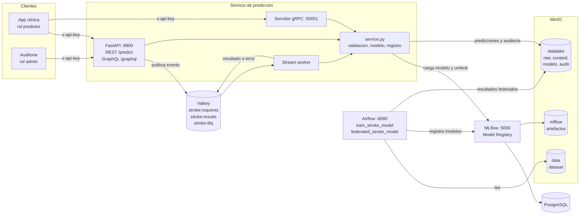
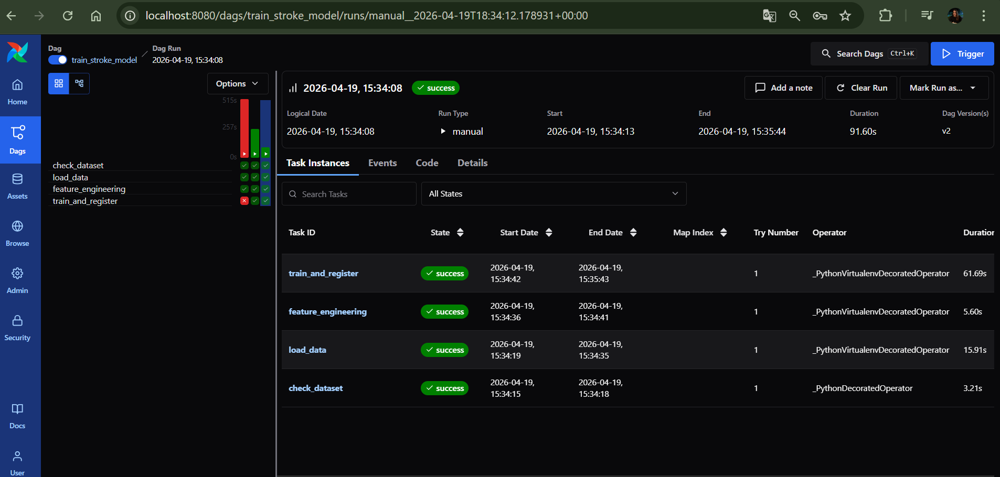
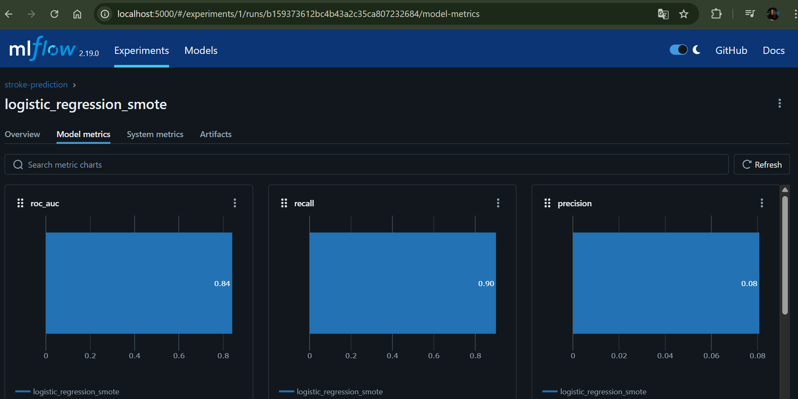
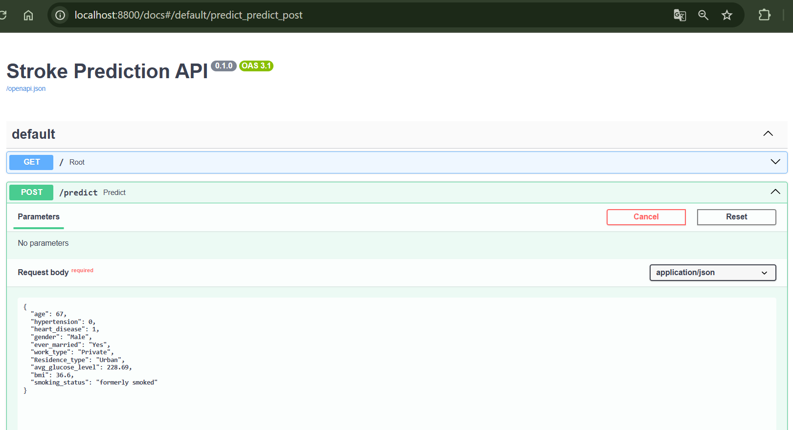
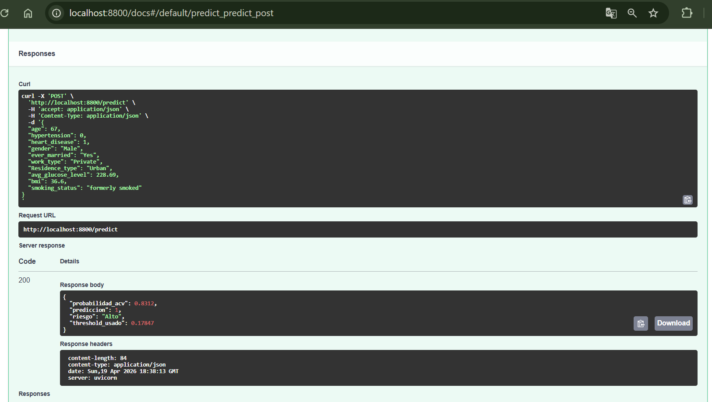

# Prediccion de ACV — plataforma MLOps

TP Final de **Operaciones de Aprendizaje Automatico II** — Posgrado en Inteligencia Artificial (CEIA, UBA).

Servicio de prediccion de riesgo de accidente cerebrovascular (ACV) para **ML Models and something more Inc.**
Parte del modelo de MLOps I (regresion logistica con SMOTE, orquestado con Airflow y versionado en MLflow) y le suma
las capas de este curso: cuatro protocolos de servicio, un Data Lake, aprendizaje federado y seguridad.

**Nivel: contenedores** — todo el sistema corre en Docker Compose, con instrucciones de instalacion y ejecucion mas abajo.

## Presentacion

- [Slides de la defensa](https://docs.google.com/presentation/d/1YUOvW3eAqhVfkGqIbW3f2-NXhz_z5ceU/edit?usp=sharing)

## Integrantes
- Sofía Belén Caselli

## Que incluye

| Capa | Implementacion | Estado | Seccion |
|---|---|---|---|
| Orquestacion | Airflow: DAG de entrenamiento (`train_stroke_model`) y de aprendizaje federado (`federated_stroke_model`) | Incluida | [Despliegue](#despliegue-paso-a-paso) |
| Ciclo de vida del modelo | MLflow: experimentos, Model Registry, umbral y version de cada modelo | Incluida | [Aprendizaje federado](#aprendizaje-federado) |
| REST | FastAPI, `POST /predict` | Incluida | [Uso de la API](#uso-de-la-api) |
| GraphQL | Strawberry, `/graphql`: predecir e historial, con autorizacion por campo | Incluida | [GraphQL](#graphql) |
| gRPC | `stroke.proto`, servidor propio en el puerto 50051 | Incluida | [gRPC](#grpc) |
| Streaming | Valkey (Redis Streams), worker con consumer group y cola de errores | Incluida | [Streaming](#streaming) |
| Data Lake | MinIO: bucket `datalake` con zonas `raw`, `curated`, `models` y `audit` | Incluida | [Data Lake](#data-lake) |
| Aprendizaje federado | FedAvg entre 5 hospitales, IID y non-IID, con privacidad diferencial | Incluida, **simulada** | [Aprendizaje federado](#aprendizaje-federado) |
| Seguridad y gobernanza | API keys con roles, rate limiting, validacion, minimo privilegio, auditoria, model card | Incluida, **sin TLS** | [Seguridad](#seguridad-y-gobernanza) |
| Monitoreo | Deriva de datos y de rendimiento del modelo | **Pendiente** | [Limitaciones](#limitaciones-conocidas) |

## Arquitectura



Los cuatro protocolos comparten la misma capa de servicio (`dockerfiles/fastapi/service.py`): mismo modelo,
mismo feature engineering, misma validacion de entrada y mismo registro de cada prediccion en el Data Lake.

Servicios de soporte: PostgreSQL (backend de Airflow y MLflow) y Valkey (broker de Celery y streaming).

## Stack tecnologico

| Servicio   | Imagen / Framework           | Puerto          |
|------------|------------------------------|-----------------|
| Airflow    | custom (CeleryExecutor)      | 8080            |
| MLflow     | custom                       | 5000            |
| MinIO      | minio/minio:latest           | 9000 / 9001 (UI)|
| FastAPI    | custom (uvicorn)             | 8800            |
| gRPC       | misma imagen que FastAPI     | 50051           |
| Stream worker | misma imagen que FastAPI  | —               |
| Valkey (Redis) | valkey/valkey:8.1        | 6379 (interno)  |
| PostgreSQL | custom                       | 5432            |

## Requisitos previos

- Docker >= 24 y Docker Compose >= 2.20
- Al menos 4 GB de RAM y 10 GB de disco disponibles para Docker
- En Linux: exportar `AIRFLOW_UID` antes de levantar los servicios:
  ```bash
  echo "AIRFLOW_UID=$(id -u)" >> .env
  ```

## Despliegue paso a paso

### 1. Clonar el repositorio

```bash
git clone <url-del-repo>
cd ceia-mlops
```

### 2. Configurar secretos

Las claves de acceso **no estan en el repositorio**. Se definen en un `.env` local (ignorado por git):

```powershell
Copy-Item .env.example .env

# Generar una clave por cada cliente y una contrasena para el usuario de MinIO de la API
python -c "import secrets; print(secrets.token_urlsafe(32))"
```

Editar `.env` y completar:

```
API_KEYS=app-clinica:predictor:<clave1>,auditoria:admin:<clave2>
API_S3_PASSWORD=<contrasena>
```

Roles: `predictor` puede predecir; `admin` ademas lee el historial, la cola de errores y la auditoria.
Si `API_KEYS` queda vacio la API rechaza todo acceso protegido, y `docker compose` no arranca sin
`API_S3_PASSWORD`. Si ya tenias un `.env`, agregar las variables nuevas de `.env.example`.

### 3. Construir las imagenes y levantar los servicios

```bash
docker compose --profile all up --build -d
```

Esto levanta todos los servicios: Airflow, MLflow, MinIO, FastAPI, el servidor gRPC, el worker de streaming, Valkey y PostgreSQL.
Esperar a que los healthchecks pasen (puede tardar 2-3 minutos).

### 4. Cargar el dataset en MinIO

**Este paso es obligatorio antes de ejecutar el DAG.** El pipeline lee `stroke-data.csv` desde el bucket `data` de MinIO.

```bash
docker cp data/stroke-data.csv minio:/tmp/stroke-data.csv
docker exec minio mc alias set local http://localhost:9000 minio minio123
docker exec minio mc cp /tmp/stroke-data.csv local/data/stroke-data.csv
```

Alternativamente, usar la UI de MinIO en http://localhost:9001 (usuario: `minio`, contrasena: `minio123`), ingresar al bucket `data` y subir el archivo `data/stroke-data.csv`.

### 5. Ejecutar el DAG de entrenamiento

1. Abrir Airflow en http://localhost:8080 (usuario: `airflow`, contrasena: `airflow`)
2. Activar y ejecutar el DAG `train_stroke_model`
3. Esperar a que todas las tareas terminen en estado **success**

El modelo quedara registrado en MLflow como `stroke-predictor`.

### 6. Probar la API

La API reintenta cargar el modelo en la primera peticion si todavia no estaba registrado al iniciar,
por lo que ya no hace falta reiniciarla despues del primer entrenamiento. Ver "Uso de la API".

## Servicios y URLs

| Servicio       | URL                        | Credenciales       |
|----------------|----------------------------|--------------------|
| Airflow UI     | http://localhost:8080      | airflow / airflow  |
| MLflow UI      | http://localhost:5000      | —                  |
| MinIO UI       | http://localhost:9001      | minio / minio123   |
| FastAPI docs   | http://localhost:8800/docs | API key (cabecera `x-api-key`) |
| GraphQL        | http://localhost:8800/graphql | API key (el playground carga sin clave; las consultas la exigen) |
| gRPC           | localhost:50051            | API key en el metadata `x-api-key` |

## Uso de la API

### Verificar estado

```bash
curl http://localhost:8800/
```

### Autenticacion

Toda operacion salvo `GET /` (healthcheck) exige la cabecera `x-api-key`. Sin clave o con una invalida
responde `401`; con una clave de rol insuficiente, `403`; al superar el limite de peticiones por minuto,
`429` con `Retry-After`.

```powershell
$KEY = "<la clave del rol predictor de tu .env>"
```

### Predecir riesgo de ACV

```bash
curl -X POST http://localhost:8800/predict \
  -H "x-api-key: $KEY" \
  -H "Content-Type: application/json" \
  -d '{
    "age": 67,
    "hypertension": 0,
    "heart_disease": 1,
    "gender": "Male",
    "ever_married": "Yes",
    "work_type": "Private",
    "Residence_type": "Urban",
    "avg_glucose_level": 228.69,
    "bmi": 36.6,
    "smoking_status": "formerly smoked"
  }'
```

Respuesta:

```json
{
  "probabilidad_acv": 0.8312,
  "prediccion": 1,
  "riesgo": "Alto",
  "threshold_usado": 0.17044
}
```

**Valores validos:**
- `gender`: `"Male"`, `"Female"`, `"Other"`
- `work_type`: `"Private"`, `"Self-employed"`, `"Govt_job"`, `"children"`, `"Never_worked"`
- `Residence_type`: `"Urban"`, `"Rural"`
- `smoking_status`: `"formerly smoked"`, `"never smoked"`, `"smokes"`, `"Unknown"`
- `age` 0-120, `hypertension` y `heart_disease` 0 o 1, `avg_glucose_level` 20-600, `bmi` 10-100,
  `ever_married` `"Yes"`/`"No"`. Valores fuera de rango, categorias desconocidas o campos extra se rechazan con `422`.

## GraphQL

Endpoint: `http://localhost:8800/graphql`. Abrirlo en el navegador muestra el playground (GraphiQL).
El cliente elige que campos del resultado quiere recibir.

```graphql
query {
  predecir(paciente: {
    age: 67, hypertension: 0, heartDisease: 1, gender: "Male", everMarried: "Yes",
    workType: "Private", residenceType: "Urban", avgGlucoseLevel: 228.69,
    bmi: 36.6, smokingStatus: "formerly smoked"
  }) {
    probabilidadAcv
    riesgo
  }
}
```

Desde PowerShell:

```powershell
$q = '{"query":"{ predecir(paciente:{age:67,hypertension:0,heartDisease:1,gender:\"Male\",everMarried:\"Yes\",workType:\"Private\",residenceType:\"Urban\",avgGlucoseLevel:228.69,bmi:36.6,smokingStatus:\"formerly smoked\"}){ probabilidadAcv prediccion riesgo thresholdUsado } }"}'
Invoke-RestMethod -Method Post -Uri http://localhost:8800/graphql -ContentType "application/json" -Headers @{"x-api-key"=$KEY} -Body $q
```

Desde el playground (GraphiQL) hay que cargar la clave en la pestana *Headers*: `{"x-api-key": "<clave>"}`.
El campo `historial` exige rol `admin` (autorizacion por campo); con rol `predictor` devuelve un error GraphQL.

## gRPC

Servicio `StrokePredictor` definido en `dockerfiles/fastapi/stroke.proto` (metodos `Predict` y `Health`).
Los stubs se generan al construir la imagen. Cliente de prueba incluido, que se ejecuta dentro del contenedor:

```bash
docker compose exec -e GRPC_API_KEY=$KEY grpc_server python grpc_client.py
```

Un cliente externo se conecta a `localhost:50051` con el `.proto` como contrato. Los datos
invalidos se rechazan con `INVALID_ARGUMENT` y, si el modelo no esta cargado, con `UNAVAILABLE`.

## Data Lake

Ademas de los buckets `data` (dataset) y `mlflow` (artefactos), hay un bucket **`datalake`**
organizado en zonas. Se crea al levantar el stack y la API asegura las zonas al iniciar.

```
datalake/
  raw/events/date=AAAA-MM-DD/<id>.json          eventos de streaming tal como llegaron
  curated/predictions/date=AAAA-MM-DD/<id>.json   una prediccion por objeto (REST, GraphQL o gRPC)
  models/v<N>/metadata.json                    version del modelo que se esta sirviendo
```

Cada registro de prediccion guarda `id`, `timestamp`, `protocolo`, `modelo_version`, la `entrada`
y el `resultado`, por lo que se puede saber que version del modelo produjo cada respuesta.
Si el lake no esta disponible, la prediccion igual se devuelve (solo se registra un aviso).

Consultar el historial:

```powershell
# REST
# (requiere la clave del rol admin)
$ADMIN = "<la clave del rol admin de tu .env>"
Invoke-RestMethod "http://localhost:8800/predictions?limit=5" -Headers @{"x-api-key"=$ADMIN}

# GraphQL
$q = '{"query":"{ historial(limite: 5) { id protocolo modeloVersion resultado { probabilidadAcv riesgo } } }"}'
Invoke-RestMethod -Method Post -Uri http://localhost:8800/graphql -ContentType "application/json" -Headers @{"x-api-key"=$ADMIN} -Body $q
```

Tambien se puede explorar el bucket `datalake` desde la consola de MinIO (http://localhost:9001).

> **Dato sensible:** el registro incluye las variables clinicas de cada paciente. No hay identificadores
> directos, pero conviene tratarlo como informacion de salud (ver capa de seguridad).

## Streaming

Flujo asincrono sobre Valkey (Redis Streams, base de datos 1):

```
productor --> stroke:requests --> stream_worker --> stroke:results
                                       |
                                       +--> stroke:dlq        (eventos invalidos + motivo)
                                       +--> datalake/raw/events/   (cada evento aterriza sin transformar)
                                       +--> datalake/curated/predictions/  (protocolo = "streaming")
```

El worker usa un *consumer group*: confirma (XACK) cada evento solo despues de procesarlo, asi que la
entrega es "al menos una vez" y si cae a mitad de camino retoma sus eventos pendientes al reiniciar.
Se puede escalar con mas replicas. Los eventos invalidos no frenan el flujo: van a la DLQ.

```powershell
# Publicar un paciente (la API responde 202 y el worker lo procesa)
$body = '{"age":67,"hypertension":0,"heart_disease":1,"gender":"Male","ever_married":"Yes","work_type":"Private","Residence_type":"Urban","avg_glucose_level":228.69,"bmi":36.6,"smoking_status":"formerly smoked"}'
Invoke-RestMethod -Method Post -Uri http://localhost:8800/stream/predict -ContentType "application/json" -Headers @{"x-api-key"=$KEY} -Body $body

# Generar carga: 20 eventos validos y 3 invalidos
docker compose exec fastapi python stream_producer.py -n 20 --invalidos 3

# Ver resultados y eventos rechazados
# (solo rol admin)
Invoke-RestMethod "http://localhost:8800/stream/results?count=5" -Headers @{"x-api-key"=$ADMIN}
Invoke-RestMethod "http://localhost:8800/stream/dlq?count=5" -Headers @{"x-api-key"=$ADMIN}

# Seguir el worker en vivo
docker compose logs -f stream_worker
```

## Aprendizaje federado

Los datos de salud no deberian salir del hospital que los genera. El DAG `federated_stroke_model`
simula **5 hospitales** que entrenan la misma regresion logistica sobre sus propios pacientes
y envian solo los **pesos** al servidor, que los promedia (**FedAvg**, ponderado por cantidad de
pacientes). Se usan las mismas 5 variables y la misma regla de umbral (recall >= 0.90 en validacion)
que el modelo de produccion, para que la comparacion sea justa.

Se corre desde Airflow (http://localhost:8080 -> DAG `federated_stroke_model` -> Trigger) o por linea de comandos:

```powershell
docker compose exec airflow-apiserver airflow dags unpause federated_stroke_model
docker compose exec airflow-apiserver airflow dags trigger federated_stroke_model
```

Si el DAG nuevo no aparece, el procesador tarda hasta 5 minutos en listar archivos; para forzarlo:
`docker compose restart airflow-dag-processor`.

**Que registra:** el experimento `stroke-federated` en MLflow (metricas, parametros y dos graficos),
el modelo `stroke-predictor-federated` en el Model Registry (con su umbral) y `resultados.json`
en `datalake/curated/federated/<run_id>/`.

**Resultados** (5 semillas, media +- desvio, conjunto de test, ~4.9 % de casos positivos).
El **ROC-AUC** mide que tan bien el modelo ordena a los pacientes por riesgo: 0.5 es azar y 1 es perfecto.

| Configuracion | ROC-AUC | PR-AUC | Recall | Precision |
|---|---|---|---|---|
| Centralizado (datos reunidos) | 0.833 +- 0.028 | 0.221 | 0.872 | 0.115 |
| Federado IID | 0.832 +- 0.028 | 0.219 | 0.876 | 0.115 |
| Federado non-IID (hospitales por tramo de edad) | 0.832 +- 0.029 | 0.221 | 0.864 | 0.114 |
| Federado non-IID + privacidad diferencial (z=2) | 0.829 +- 0.027 | 0.197 | 0.852 | 0.115 |

Como control, `LogisticRegression` de sklearn entrenada con todos los datos da el mismo AUC (0.833),
lo que valida la implementacion de FedAvg.

**Lectura de los resultados**
- Federar este modelo **casi no cuesta performance**: es una regresion logistica de 5 variables
  (convexa y muy simple), por lo que promediar modelos locales llega al mismo optimo.
- En el escenario non-IID los hospitales son muy distintos (prevalencia de ACV de 0 % a 16.5 %
  segun la edad de sus pacientes) y aun asi el resultado no cambia.
- La heterogeneidad **si** hace dano cuando cada hospital entrena casi hasta converger antes de
  promediar (*client drift*), con el mismo computo total. La comparacion correcta es **pareada**
  (misma particion train/test, AUC del IID menos AUC del non-IID), porque el desvio entre semillas
  mezcla la variacion de la particion con el efecto:

| Epocas locales por ronda | 1 | 20 | 50 | 200 | 1000 |
|---|---|---|---|---|---|
| AUC IID (promedio) | 0.833 | 0.832 | 0.832 | 0.832 | 0.832 |
| AUC non-IID (promedio) | 0.833 | 0.831 | 0.828 | 0.810 | 0.774 |
| Perdida del non-IID (promedio) | 0.000 | 0.001 | 0.004 | 0.022 | 0.058 |
| Particiones donde el non-IID pierde | 3 de 5 | 3 de 5 | 5 de 5 | 5 de 5 | 5 de 5 |

  Hasta 20 epocas locales no hay efecto medible. Desde 50 el non-IID pierde en las 5 particiones, pero
  la magnitud es chica (0.004 a 50 epocas, 0.022 a 200). A 1000 epocas la perdida varia mucho segun
  la particion (de 0.008 a 0.139): el promedio de 0.058 esta dominado por dos particiones, y en las otras
  tres la caida es de ~0.01. Con solo 5 particiones y 249 positivos, conviene leerlo como una tendencia.
- Por ronda, el non-IID arranca mas lento (AUC de validacion 0.789 contra 0.791 en la ronda 1 y mas
  rezagado en las primeras rondas) pero en ~20 rondas alcanza el nivel del IID y del centralizado.
- Privacidad diferencial (recorte de cada actualizacion a norma 0.5 + ruido gaussiano): el costo
  es chico en AUC y se nota mas en PR-AUC y recall (0.221 -> 0.197 con z=2).

**Limites a tener en cuenta**
- Es una **simulacion**: los 5 "hospitales" salen de partir un unico dataset, no son silos reales.
- Ademas de los pesos se comparten estadisticos agregados (conteos, sumas y sumas de cuadrados para
  estandarizar, y el balance de clases). En un despliegue real irian protegidos con agregacion segura.
- La privacidad diferencial es por cliente y **no calcula un epsilon formal** (no hay contador de
  privacidad). Con solo 5 clientes la garantia seria debil aunque se calculara.
- El AUC de validacion/test tiene desvio alto (+-0.028) por la poca cantidad de casos positivos (249):
  las diferencias de milesimas entre configuraciones no son significativas.

**Servir el modelo federado:** la API puede servir cualquiera de los dos modelos. Se elige con la
variable `MODEL_NAME` y toma el umbral del modelo desde MLflow (el federado usa ~0.30, el centralizado ~0.17).

```powershell
# en .env:  MODEL_NAME=stroke-predictor-federated
docker compose --profile all up -d --force-recreate fastapi grpc_server stream_worker
```

## Seguridad y gobernanza

El sistema procesa datos de salud, por lo que el acceso esta controlado en los cuatro protocolos:

| Control | Detalle |
|---|---|
| Autenticacion y roles | API key (`x-api-key`) con roles `predictor` y `admin`; falla cerrada si no hay claves |
| Autorizacion por campo | En GraphQL, `historial` solo para `admin` |
| Rate limiting | 60 peticiones por minuto por cliente (compartido entre protocolos) y bloqueo por fuerza bruta |
| Validacion estricta | Rangos, categorias cerradas y sin campos extra (`422`) |
| Minimo privilegio | La API usa un usuario de MinIO sin permiso para borrar ni para escribir en MLflow |
| Auditoria | Accesos denegados, rate limit y lecturas administrativas en `datalake/audit/` (`GET /audit`) |

Verificar los controles (30 casos de REST y GraphQL; `--carga` agrega fuerza bruta y rate limit):

```powershell
python scripts/probar_seguridad.py
python scripts/probar_seguridad.py --carga
```

gRPC se prueba desde dentro del contenedor:

```powershell
docker compose exec -e GRPC_API_KEY=$KEY grpc_server python grpc_client.py
```

**Limites:** no hay TLS, las claves son estaticas y el resto del stack conserva credenciales por defecto.

## Estructura del repositorio

```
ceia-mlops/
  airflow/dags/
    train_stroke_model.py       DAG de entrenamiento del modelo centralizado
    federated_stroke_model.py   DAG de aprendizaje federado (FedAvg entre hospitales)
    federated_lib.py            algoritmo federado, particiones, privacidad diferencial y metricas
    config.py
  dockerfiles/
    fastapi/                    servicio de prediccion (imagen compartida por API, gRPC y worker)
      app.py                    REST y GraphQL
      service.py                logica de prediccion comun a los cuatro protocolos
      schemas.py                validacion estricta de entrada
      security.py, audit.py     autenticacion, roles, rate limiting y auditoria
      lake.py                   Data Lake: zonas, predicciones, eventos y metadatos del modelo
      graphql_schema.py         esquema GraphQL
      stroke.proto, grpc_server.py, grpc_client.py
      stream.py, stream_worker.py, stream_producer.py
      model.py, preprocessing.py
    minio/init-minio.sh         buckets y usuario de minimo privilegio
    airflow/, mlflow/, postgres/
  docs/
    demo_federacion.html        simulador interactivo de la federacion (datos sinteticos, se abre en el navegador)
  scripts/probar_seguridad.py   prueba reproducible de los controles de seguridad
  notebooks/TpFinal.ipynb       desarrollo original del modelo (MLOps I)
  data/stroke-data.csv
  docker-compose.yaml, .env.example
```

## Decisiones de diseno

- **Una sola capa de servicio para los cuatro protocolos.** REST, GraphQL, gRPC y streaming llaman a la misma
  funcion `predecir()`. Asi el modelo, la validacion, el umbral y el registro no pueden divergir entre protocolos, y
  cada control de seguridad se escribe una vez.
- **Streaming con Valkey en lugar de Kafka.** Valkey ya estaba en el stack (broker de Celery). Redis Streams ofrece
  consumer groups, confirmacion de eventos y cola de errores, con mucho menos costo operativo que sumar Kafka y
  Zookeeper para este volumen. Es entrega "al menos una vez".
- **El umbral viaja con el modelo.** Cada entrenamiento registra su umbral en MLflow y la API lo lee de ahi. Antes
  estaba fijo en una variable de entorno y se desincronizaba al reentrenar.
- **Federado simulado, con el costo medido.** Los hospitales salen de partir un solo dataset. El experimento muestra
  que, para este modelo, federar casi no cuesta rendimiento, y en que condiciones si (muchas epocas locales).
- **Minimo privilegio.** La API, el servidor gRPC y el worker usan un usuario de MinIO que no puede borrar objetos ni
  tocar los modelos; solo Airflow y MLflow usan el usuario raiz.
- **Falla cerrada.** Sin claves configuradas la API rechaza todo acceso protegido, y el compose no arranca sin la
  contrasena del usuario de MinIO.

## Conclusiones

1. **Una capa, cuatro protocolos.** El mismo paciente recibe la misma respuesta por REST, GraphQL, gRPC y streaming,
   porque los cuatro comparten la misma capa de servicio.
2. **Federar casi no cuesta rendimiento.** ROC-AUC de 0.832 federado contra 0.833 centralizado: una diferencia de una
   milesima. El costo aparece solo cuando cada hospital entrena mucho antes de promediar, sobre datos heterogeneos.
3. **Trazabilidad de punta a punta.** Cada prediccion queda en el Data Lake con el protocolo y la version del modelo
   que la produjo.
4. **Un modelo para priorizar.** Es casi un puntaje de edad: apoya la decision clinica, no la reemplaza.
5. **Seguridad verificada.** Los controles se probaron contra el sistema real y lo que falta esta documentado
   (ver [Seguridad y gobernanza](#seguridad-y-gobernanza)).

## Limitaciones conocidas

Las principales:

- **El modelo es debil como herramienta de decision.** Es casi un puntaje de edad: para detectar el 90 % de los casos
  marca a mas de la mitad de los pacientes, con 8 % de precision. Apoyo a la priorizacion, no diagnostico.
- **Sin TLS** y con claves estaticas; el resto del stack conserva credenciales de ejemplo.
- **Sin verificacion de integridad del modelo** al cargarlo, ni agregacion robusta contra envenenamiento en el federado.
- **La API sirve siempre la ultima version** del modelo registrado: no hay promocion condicionada
  (champion/challenger) ni *rollback* a una version anterior.
- **Sin monitoreo de deriva** ni politica de retencion de los datos clinicos que guarda el historial.
- **Minimizacion de datos:** la API pide 10 campos y el modelo usa 5.

## Evidencia de funcionamiento

### 1. DAG ejecutado en Airflow


### 2. Experimento registrado en MLflow


### 3. Respuesta del endpoint /predict




## Detener los servicios

```bash
docker compose --profile all down
```

Para eliminar tambien los volumenes (base de datos, modelos y datos en MinIO):

```bash
docker compose --profile all down -v
```
